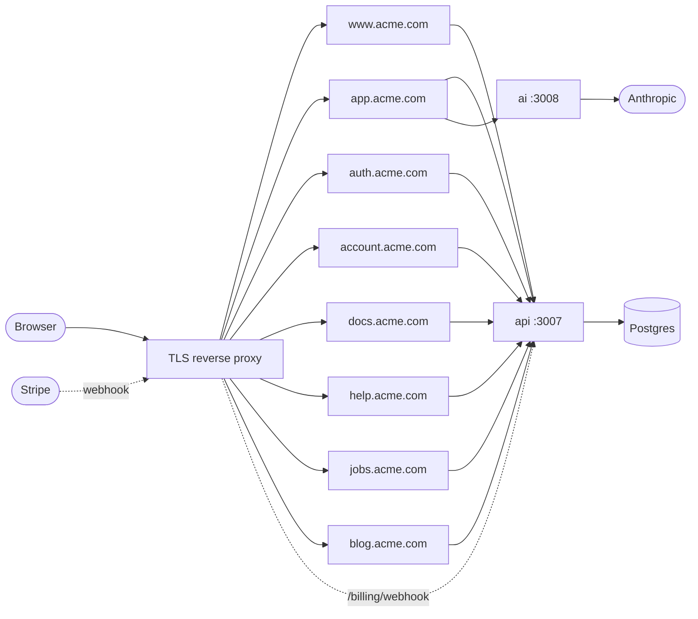

# Deploying

The starter runs in production as ten containers, one per app, built from the two Dockerfiles in
`docker/`. This guide takes you from a parent domain you own to a working deploy: what to decide
before building, how to build and publish the images, what each container needs at runtime, and
what to set up once it is live. It uses `acme.com` as the example domain; substitute your own.

## Topology

Every app gets its own subdomain behind one TLS-terminating reverse proxy (Caddy, Traefik, nginx, a
cloud load balancer). The browser only ever talks to the eight Next apps: they call `api` and `ai`
server to server with a bearer token, so neither service is ever called from browser code.



- **The api is internal, with one exception.** The Next apps reach it on the private network (in
  Compose, `http://api:3007`). Stripe is the only outside caller: if you turn on Stripe billing,
  route `api.acme.com` to it so `POST /billing/webhook` is reachable (its signature over the raw
  body is the authentication there, not a bearer token). `/health`, `/ready`, `/openapi` and
  `/openapi/spec.json` are open too — the docs and spec, not data, and harmless to expose — but
  every procedure under `/rpc/*` and `/openapi/*` needs the bearer token. Without Stripe, have the
  proxy expose only what each app actually needs rather than the whole host — `POST /billing/webhook`
  if you turn billing on later, nothing if you don't.
- **`ai` is internal.** Only `app` calls it (`/api/chat`, forwarded server to server).
- **The api migrates on boot.** `createServer` runs `db.migrate()` before it listens
  (`apps/api/src/server.ts`), so a new image applies its new migrations when it starts. Migrations
  are forward-only: rolling the image back after a deploy that added one fails at boot instead —
  `migrate()` (`apps/api/src/migrate.ts`) throws `unknown migration "…": this build is older than
  the database`, so roll forward or restore the database rather than downgrade the image. Concurrent
  replicas starting together are serialised by a Postgres advisory lock
  (`pg_advisory_xact_lock`), so only one of them applies a given migration. To apply migrations as
  an explicit pre-deploy step instead of relying on boot, run
  `bun run --filter @repo/api db:migrate` against `DATABASE_URL` (`apps/api/src/migrate-cli.ts`).
- **Background jobs run inside the api by default.** Every api replica also runs the job worker and
  scheduler (mail, storage deletes, Sentry forwarding, the prunes — see
  [background-jobs.md](background-jobs.md)). To run them apart, deploy the same `api` image a second
  time with the command `bun dist/worker.js` (the worker alone; it serves only `GET /health`, on its
  own `PORT`) and set `JOBS_WORKER=false` on the api replicas. Deploy the worker with or after the
  api code that defines a new job: an older worker that claims a job it does not know kills it.
- **Postgres in production.** `DATABASE_URL` takes `sqlite://` or `postgres://` (`Bun.sql`). SQLite
  on the `/data` volume (`DATABASE_URL=sqlite:///data/api.db`, as `docker-compose.yml` uses) works
  for a single api container; use Postgres as soon as you run more than one, or want a managed
  provider's own backups on top of the api's own (see below).
- **Backups.** `BACKUP_ENABLED=true` turns on a nightly logical dump of the database into your
  storage bucket, with a tested restore and incident runbooks: `docs/guides/operations.md`'s
  **Backups and runbooks** section.

`docker-compose.yml` is the same topology on localhost ports and makes a good reference for the
wiring; it isn't a production file (no proxy, empty `COOKIE_DOMAIN`, Mailpit for mail).

## Before building

**Rename first.** If you haven't renamed the brand yet, do it before building: the static apps
(`www`, `docs`, `help`, `jobs`, `blog`) bake `BRAND_NAME` into their images at `next build`, so renaming
after you've already built and published means rebuilding every one of them anyway. See
[renaming-the-brand.md](renaming-the-brand.md).

**DNS.** Point `www`, `app`, `auth`, `account`, `docs`, `help`, `jobs` and `blog` (plus `api` if
you use Stripe) at the proxy, one record each or a single wildcard `*.acme.com`. Nothing in the
starter serves the bare apex `acme.com`; redirect it wherever you like (usually `www`).

**Values.** Decide these once; several are shared by more than one container.

| Value | Example | Read by |
|---|---|---|
| `SITE_DOMAIN` | `acme.com` | every Next image at build time; `app`, `auth`, `account` and `api` at runtime (for `api` it is also the passkey relying party id) |
| `COOKIE_DOMAIN` | `.acme.com` | `app`, `auth`, `account` at runtime (session, workspace and consent cookies); the static apps at build time (consent cookie only) |
| `AUTH_URL` | `https://auth.acme.com` | `api`, `app`, `auth`, `account` |
| `APP_URL` | `https://app.acme.com` | `api`, `app`, `auth`, `account` |
| `ACCOUNT_URL` | `https://account.acme.com` | `api` |
| `API_URL` | `http://api:3007` (the private address) | every Next app, `ai` |
| `API_SERVICE_TOKEN` | `openssl rand -hex 32` | `api` and every caller of it |
| `AI_SERVICE_URL` | `http://ai:3008` (the private address) | `app` |
| `AI_SERVICE_TOKEN` | `openssl rand -hex 32` | `ai` and `app` |
| `DATABASE_URL` | `postgres://user:pass@db:5432/acme` | `api` |
| `TWO_FACTOR_ENCRYPTION_KEY` | `openssl rand -base64 32` | `api` (encrypts the stored TOTP secrets) |

Generate each token separately:

```bash
openssl rand -hex 32
```

Both services refuse a token shorter than 32 characters, and refuse the public development token,
in production. The Next apps send the same `API_SERVICE_TOKEN` / `AI_SERVICE_TOKEN` the services
expect; a mismatch is a `401` on every call, not a startup error.

Then pick the providers, all read by `api` only:

- **Mail:** `MAIL_PROVIDER=smtp` (with `SMTP_URL`) or `resend` (with `RESEND_API_KEY`), and
  `MAIL_FROM` on a domain the provider will send for. The default, `log`, only prints mail —
  sign-up verification, password resets and invitations would never arrive.
- **Billing:** `BILLING_PROVIDER=stripe` and the six `STRIPE_*` vars — see
  [stripe.md](stripe.md). Without it the mock activates paid plans for free.
- **Storage:** `STORAGE_PROVIDER=s3` and the four required `S3_*` vars (plus `S3_ENDPOINT` for R2,
  MinIO, SeaweedFS or another non-AWS bucket) — see [storage.md](storage.md). The default, `local`,
  keeps avatars and logos on the api container's disk, lost with the container unless `STORAGE_DIR`
  is on a volume, and split across replicas. Use a bucket of its own for each environment: the
  nightly `storage.sweep` deletes every object its database does not reference, so staging and
  production sharing one bucket delete each other's files.
- **Social sign-in:** optional `OAUTH_*` groups — see [oauth-providers.md](oauth-providers.md).
- **Admins:** `SUPERADMIN_EMAILS`, the addresses that may open `/admin` once verified.

`ai` needs a model key too: `ANTHROPIC_API_KEY` for the default `AI_MODEL`
(`anthropic:claude-opus-5`).

## Build and publish

The images bake the domain in. The static apps (`www`, `docs`, `help`, `jobs`, `blog`) write their
cross-app links and the consent cookie's domain into the HTML at `next build`; `app`, `auth` and
`account` read `SITE_DOMAIN` per request from the `ENV` the same build arg sets. An image built
without `SITE_DOMAIN` links to `brand.localhost`, and a new domain means a rebuild, not a new runtime
variable.

### With GitHub Actions

`.github/workflows/docker-build.yml.disabled` builds all ten images and pushes them to GHCR on every
push to `main` (`ghcr.io/<owner>/<repo>/<app>:<branch | sha | latest>`).

1. **Settings → Secrets and variables → Actions → Variables**, add the repository variables:
   - `SITE_DOMAIN` — required, e.g. `acme.com`. The workflow fails before building without it,
     rather than publish images that link to `brand.localhost`.
   - `COOKIE_DOMAIN` — optional, `.`-prefixed, e.g. `.acme.com`. It's the consent cookie's domain
     on the static apps; empty writes a host-only consent cookie, so a visitor's choice on `www` is
     not shared with `docs`. (`app`, `auth` and `account` take `COOKIE_DOMAIN` at runtime, below.)
   - `CONTENT_REPO_URL` — optional, `docs` only, e.g.
     `https://github.com/acme/starter/blob/main/apps/docs/content/docs`: the "Edit on GitHub" link's
     base (see **By hand** below). Unset, no link appears.
2. Rename the workflow to `.github/workflows/docker-build.yml` and push to `main`.

Every variable is passed to every matrix row as a build arg; the Bun services ignore them, and
only `docs` reads `CONTENT_REPO_URL`.

### By hand

The same build, from the repository root, one image per app:

```bash
docker build -f docker/next.Dockerfile --build-arg APP=docs --build-arg PORT=3004 \
  --build-arg SITE_DOMAIN=acme.com --build-arg COOKIE_DOMAIN=.acme.com \
  --build-arg CONTENT_REPO_URL=https://github.com/acme/starter/blob/main/apps/docs/content/docs \
  -t acme/docs .
docker build -f docker/bun-service.Dockerfile --build-arg APP=api --build-arg PORT=3007 -t acme/api .
```

`CONTENT_REPO_URL` is `docs`-only and optional — baked in at build (every `docs` route is static),
it puts "Edit on GitHub" at the foot of every page, the page's file path appended. Leave it unset
for no link. `docker-compose.yml`'s `docs` service reads it from `${CONTENT_REPO_URL:-}` the same
way it reads `SITE_DOMAIN` and `COOKIE_DOMAIN`.

`APP` is the folder under `apps/`; `PORT` is the app's dev port (`www` 3000 through `jobs` 3006,
`api` 3007, `ai` 3008, `blog` 3009), which the container listens on. Use `docker/next.Dockerfile`
for the eight Next apps and `docker/bun-service.Dockerfile` for `api` and `ai`.

To check an image before shipping it, run a static app and look for its links:

```bash
docker run --rm -d -p 3104:3004 --name check-docs acme/docs
curl -s localhost:3104/ | grep -o 'https://[a-z]*\.acme\.com' | sort -u   # www., app., auth., …
curl -s localhost:3104/ | grep -c brand.localhost                          # 0
docker rm -f check-docs
```

## Run

Every image runs with `NODE_ENV=production`. Each table below marks what's required: a missing
required value fails closed at boot, except where the table says otherwise (`app`'s
`AI_SERVICE_*`, needed only on the first `/api/chat` request; `docs` and `blog`, which
require nothing; mail and billing, which only warn and run in their keyless mode). `help` and
`jobs` need `API_URL` / `API_SERVICE_TOKEN` like `www` does, for `help`'s `/contact` form and
`jobs`'s `/<slug>/apply` form. "Boot" means the
process refuses to start (Bun services) or Next logs `Failed to prepare server … <KEY> is not set`
and answers 500 to every request, `/api/health` included, so the health check reports it unhealthy.

### `api`

From `apps/api/src/env.ts`. All failures are at boot.

| Variable | Required | Notes |
|---|---|---|
| `API_SERVICE_TOKEN` | yes | at least 32 characters, not the dev token |
| `AUTH_URL`, `APP_URL`, `ACCOUNT_URL` | yes | the public `https://` URLs; links in mail point at them |
| `TWO_FACTOR_ENCRYPTION_KEY` | yes | 32 bytes, base64 (`openssl rand -base64 32`); not the public development key. Keep it: a new key cannot decrypt the stored secrets, so every user with two-step verification on is down to their recovery codes, or an admin reset |
| `DATABASE_URL` | effectively | the default, `sqlite://.data/api.db`, resolves under `/app`, which is root-owned while the process runs as `bun` — it fails at boot in the image. Set it: `postgres://…`, or `sqlite:///data/api.db` with a volume on `/data` (writable by `bun`, see the Dockerfile) |
| `SITE_DOMAIN` | effectively | the passkey relying party id (`PASSKEY_RP_ID`'s default) and the waitlist welcome mail's link. Unset, both fall back to `brand.localhost`, which covers neither `AUTH_URL`'s nor `ACCOUNT_URL`'s host, so the api exits at boot naming the RP ID and the two hosts — set it, or `PASSKEY_RP_ID` ([passkeys.md](passkeys.md)) |
| `PASSKEY_RP_ID` | no | overrides the relying party id `SITE_DOMAIN` gives; it must equal, or be a parent domain of, both the `AUTH_URL` and `ACCOUNT_URL` hosts, or the api exits at boot |
| `MAIL_PROVIDER` | recommended | `smtp` needs `SMTP_URL`, `resend` needs `RESEND_API_KEY`; either needs `MAIL_FROM`. `log` (default) or `file` only warns |
| `BILLING_PROVIDER` | recommended | `stripe` needs all six `STRIPE_*` vars ([stripe.md](stripe.md)); `mock` (default) only warns |
| `STORAGE_PROVIDER` | recommended | `s3` needs `S3_BUCKET`, `S3_REGION`, `S3_ACCESS_KEY_ID` and `S3_SECRET_ACCESS_KEY` ([storage.md](storage.md)); `local` (default) only warns in production |
| `S3_ENDPOINT` | no | an S3-compatible endpoint other than AWS: `https://<account>.r2.cloudflarestorage.com` (R2, with `S3_REGION=auto`), a MinIO or SeaweedFS URL… Empty → AWS S3 in `S3_REGION` |
| `STORAGE_DIR` | with `local` | the image sets `/data/storage` (writable by `bun`, unlike the root-owned `/app`); mount a volume on `/data`, like the SQLite database, or uploads go with the container |
| `STORAGE_PUBLIC_URL` | no | a public bucket or a CDN in front of one: image URLs become `<url>/<key>` instead of each app's `/files/<key>` route; a removed image lingers until the CDN expires it |
| `OAUTH_GOOGLE_*`, `OAUTH_GITHUB_*`, `OAUTH_APPLE_*` | no | all of a provider's vars or none; a partial group stops the api ([oauth-providers.md](oauth-providers.md)) |
| `SUPERADMIN_EMAILS` | no | empty: nobody can open `/admin` |
| `TELEMETRY_PROVIDER` | no | `sentry` needs `SENTRY_DSN` ([sentry.md](sentry.md)) |
| `ANALYTICS_PROVIDER` | no | `posthog` needs `POSTHOG_KEY` + `POSTHOG_HOST`; `plausible` needs `PLAUSIBLE_DOMAIN` + `PLAUSIBLE_HOST` ([analytics.md](analytics.md)) |
| `JOBS_WORKER` | no | default `true`: this process runs the job worker and scheduler. `false` on the api replicas when a dedicated worker runs them ([background-jobs.md](background-jobs.md)) |
| `JOBS_CONCURRENCY`, `JOBS_POLL_MS` | no | jobs at once per process (default 4, 1–50); idle poll interval in ms (default 1000, 100–60 000). The worker reads them too |
| `REALTIME_BUS` | no | default from `DATABASE_URL`: `postgres` for Postgres (`NOTIFY` / `LISTEN` on two connections of its own), `memory` for SQLite (one process only); set to override ([realtime.md](realtime.md)) |
| `REALTIME_MAX_STREAMS` | no | open event streams per api process (default 1000); the next one answers `503` |
| `API_RATE_LIMIT`, `SIGNUP_RATE_LIMIT`, `MAGIC_LINK_RATE_LIMIT`, `PASSWORD_RESET_RATE_LIMIT` (and their `*_WINDOW_SECONDS`), `SIGNUP_EMAIL_RATE_LIMIT`, `TELEMETRY_RATE_LIMIT`, `ANALYTICS_RATE_LIMIT` | no | see **Replicas** below |
| `ANALYTICS_RETENTION_DAYS` | no | default 90; raw pageview/event rows (`analytics_daily` is kept indefinitely) |

`HOST` (`0.0.0.0`) and `PORT` are set by the image.

### `ai`

From `apps/ai/src/env.ts` and `apps/ai/src/models.ts`. All failures are at boot.

| Variable | Required | Notes |
|---|---|---|
| `AI_SERVICE_TOKEN` | yes | at least 32 characters, not the dev token; `app` sends the same value |
| `ANTHROPIC_API_KEY` | yes, for `anthropic:*` models | the provider key for `AI_MODEL`; `AI_MODEL=mock:echo` needs none |
| `AI_MODEL` | no | `provider:model`, default `anthropic:claude-opus-5` |
| `API_URL`, `API_SERVICE_TOKEN` | no | both set: `ai` reports its failures through the api's telemetry |
| `AI_ALLOWED_ORIGINS` | no | exact origins allowed to send an `Origin` header; the Next apps call server to server and send none |

### `app`, `auth`, `account`

From `packages/session/src/env.ts`: `src/instrumentation.ts` in each calls `assertAuthEnv()` at boot.

| Variable | Required | Fails |
|---|---|---|
| `API_URL`, `API_SERVICE_TOKEN` | yes | at boot |
| `COOKIE_DOMAIN` | yes, `.acme.com` | at boot — there is no host-only mode; an empty value counts as missing |
| `AUTH_URL`, `APP_URL` | yes | at boot |
| `AI_SERVICE_URL`, `AI_SERVICE_TOKEN` | `app` only, for chat | on the first `/api/chat` request |

`SITE_DOMAIN` comes from the image (the build arg is also set as `ENV`); you don't set it at runtime.

### `www`, `help`, `jobs`

`apps/www/src/instrumentation.ts`, `apps/help/src/instrumentation.ts` and
`apps/jobs/src/instrumentation.ts` all call `assertEnv(["API_URL", "API_SERVICE_TOKEN"])`: both
vars are required at boot — for `www`'s contact and booking server actions (`leads.create`, `booking.*`), for `help`'s `/contact` form
server action (`support.create`), for `jobs`'s `/<slug>/apply` form server action (`jobs.apply`).
`SITE_DOMAIN` and `COOKIE_DOMAIN` were baked in at build.

### `docs`, `blog`

Nothing is required at runtime. `API_URL` and `API_SERVICE_TOKEN` are optional: with both, the
app's `/api/telemetry` route forwards browser errors and web vitals to the api; without them it
drops them (and logs that it did). `docs` alone also takes `CONTENT_REPO_URL`, baked in at build
(see **Build and publish** above) — unset, "Edit on GitHub" just doesn't appear; there is nothing
to set for it at runtime.

### Health checks

| Image | Endpoint | Meaning |
|---|---|---|
| Next apps | `GET /api/health` | the server is up and its boot check passed |
| `api` | `GET /health` | the process is up (liveness) |
| `api` | `GET /ready` | the database answers; `503` while shutting down. The image's `HEALTHCHECK` uses this one |
| `ai` | `GET /health`, `GET /ready` | up / ready; the image's `HEALTHCHECK` uses `/ready` |
| `api` as a worker (`bun dist/worker.js`) | `GET /health` | the database answers; `503` while shutting down. It serves no `/ready`, so override the image's `HEALTHCHECK` (Compose's `api-worker` does) |

Both Dockerfiles declare a `HEALTHCHECK`, so `docker ps` and Compose's `service_healthy` work
without extra config (except for a dedicated job worker, above); point your orchestrator's probes at
the same paths.

### The proxy

- **Client IPs.** Anonymous calls (sign-in, sign-up, password reset, magic link, the waitlist) are
  rate limited per browser using `x-real-ip`, else the first entry of `x-forwarded-for`
  (`requestInfo` in `packages/session/src/request-info.ts`). Have the proxy **set** `x-real-ip`, or
  **overwrite** `x-forwarded-for` with the client address — appending lets a client put any value
  first. Without a proxy, `next start` fills `x-forwarded-for` from the socket address, but a client
  can send its own `x-real-ip` / `x-forwarded-for` and Next keeps it, so the key is best-effort.
  Behind a proxy that sets neither header, every anonymous caller of an app shares the proxy's
  bucket.
- **`Host`.** Pass the public `Host` through. A proxy that rewrites it makes Next's Origin check
  refuse every server action (sign-in, sign-out, every form) until the public origin is listed in
  `experimental.serverActions.allowedOrigins` in that app's Next config (for example
  `apps/auth/next.config.mjs`; `apps/www/next.config.ts` for `www`).
- **Event streams.** `app`'s `/api/events` (live notes and presence on `/notes`) is a
  `text/event-stream` response that stays open. The proxy must not buffer it — nginx:
  `proxy_buffering off;` (the relay also sends `X-Accel-Buffering: no`, which nginx honours);
  Caddy: `flush_interval -1` in the `reverse_proxy` block — and every idle timeout on the path
  must be above 25 s, the ping interval, or quiet streams are cut and reconnect on a loop. Each
  open page holds one connection through the proxy, the Next app and the api. See
  [realtime.md](realtime.md).
- **One parent domain.** Every host under `COOKIE_DOMAIN` can set the `session` cookie. Never serve
  user-controlled content on a subdomain of it.

### Replicas

The Next apps and `ai` hold no state; run as many as you like. The api keeps state in the database,
except its rate limiters, which are in memory and per process (`API_RATE_LIMIT`, the sign-up,
magic-link, sign-in, reset, waitlist, invitation, workspace, two-factor and upload limiters; `ai`'s `AI_RATE_LIMIT`
likewise). With N replicas each limit is effectively N times its setting, so lower the
api-wide caps (`SIGNUP_RATE_LIMIT`, `MAGIC_LINK_RATE_LIMIT`, `PASSWORD_RESET_RATE_LIMIT`) to match. More than one api replica
also needs Postgres, not SQLite, and `STORAGE_PROVIDER=s3`: with `local` each replica keeps its own
uploads, so an image is found only by the replica that stored it. The job queue needs nothing per
replica: claims never hand one job to two workers (`FOR UPDATE SKIP LOCKED` on Postgres), and each
schedule runs once per minute however many workers tick it. Realtime needs Postgres too: on SQLite the
`memory` bus fans out within one process only, so with several api replicas a note created on one
would never reach streams held by another; the `postgres` bus (`REALTIME_BUS` defaults to it on
Postgres) reaches them all. Each replica publishes its own presence, and clients merge them.

## After the first deploy

1. **Superadmin.** With your address in `SUPERADMIN_EMAILS`, sign up at
   `https://auth.acme.com/signup` and click the verification link in the email. `/admin` on the auth
   app opens once the address is verified — no seeding, no restart.
2. **Mail.** That verification email is the mail test. If it doesn't arrive, check the api's log for
   `mail sent verifyEmail to …` (logged by whichever process runs the jobs: the api, or the
   dedicated worker) or the provider's error. A failing provider retries the `mail.send` job and,
   after 5 attempts, shows it as dead on `/admin`; a failure to enqueue it answers `500` to the
   sign-up although the account was created.
3. **Stripe.** Create the webhook endpoint at `https://api.acme.com/billing/webhook`, the Customer
   Portal and the prices: [stripe.md](stripe.md).
4. **Social sign-in.** Register `https://auth.acme.com/oauth/<provider>/callback` with each provider:
   [oauth-providers.md](oauth-providers.md).
5. **Telemetry.** Errors and vitals land in the api's tables and on `/admin` by default; to forward
   errors to Sentry too, see [sentry.md](sentry.md).
6. **Smoke test.**
   - `curl https://<app>.acme.com/api/health` for each of the eight apps answers
     `{"status":"healthy",…}`.
   - Sign up a second account, verify it, create a workspace and add a note on
     `https://app.acme.com/notes`.
   - Open `https://www.acme.com` and check a header link goes to `https://docs.acme.com`, not
     `brand.localhost`.
   - Accept the cookie banner on `www`, open `docs`: no banner (the shared `COOKIE_DOMAIN` works).

## On Vercel

The Next apps also deploy to Vercel, one project per app:

- **Root Directory**: the app's folder, e.g. `apps/docs`. Keep "Include files outside the root
  directory" on — the apps import `packages/*`. Vercel detects the Bun workspace and installs from
  the repository root.
- **Environment variables** per project, as in **Run** above, plus `SITE_DOMAIN` and, for the
  static apps, `COOKIE_DOMAIN` — Vercel exposes them to `next build` as well, which is where the
  static apps read them.
- **Domains:** attach `<name>.acme.com` to each project.

`api` and `ai` are long-running Bun servers and stay on a container host (the
`docker/bun-service.Dockerfile` images); set `API_URL` and `AI_SERVICE_URL` on the Vercel projects to
their public `https://` addresses, since the private network is gone.
